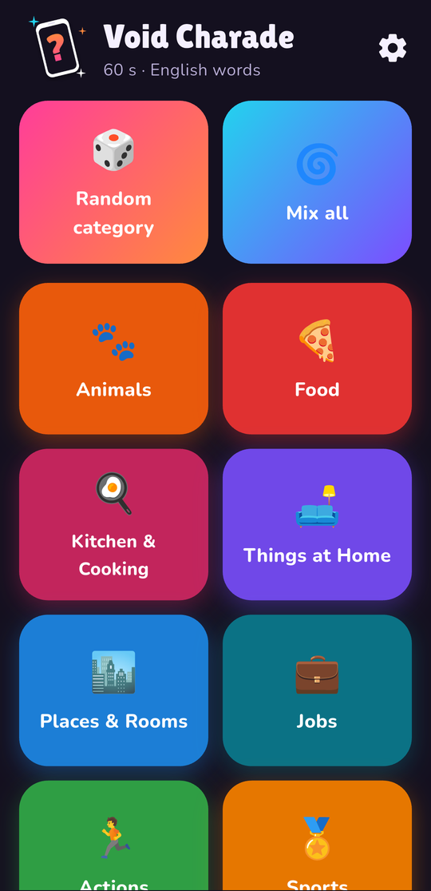
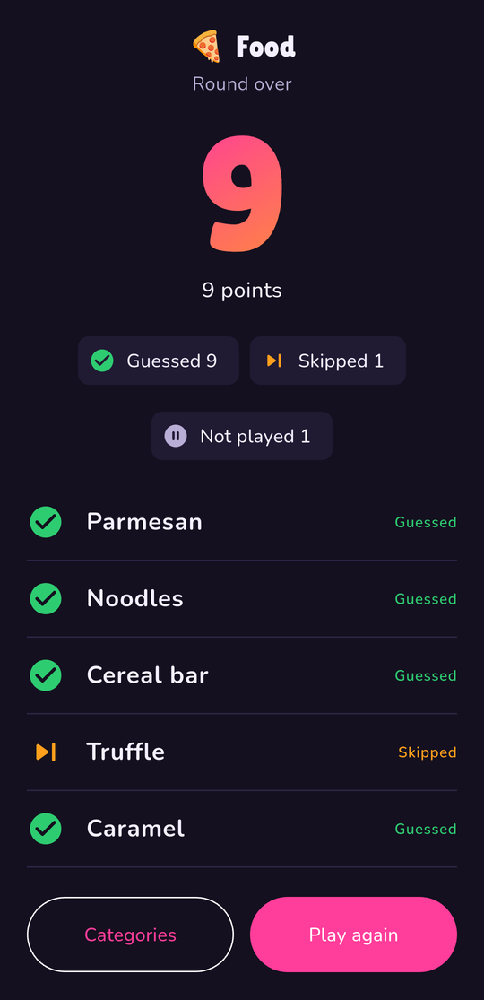
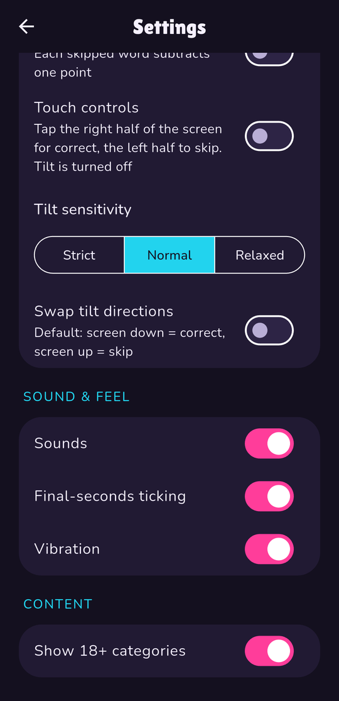
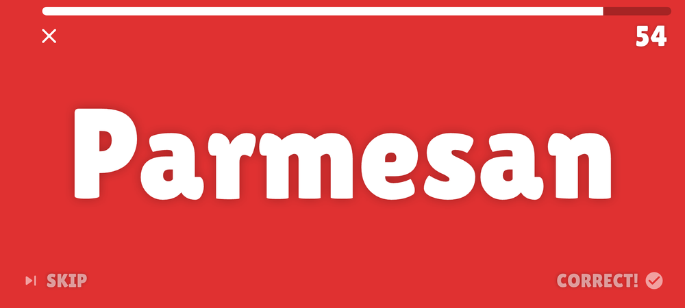
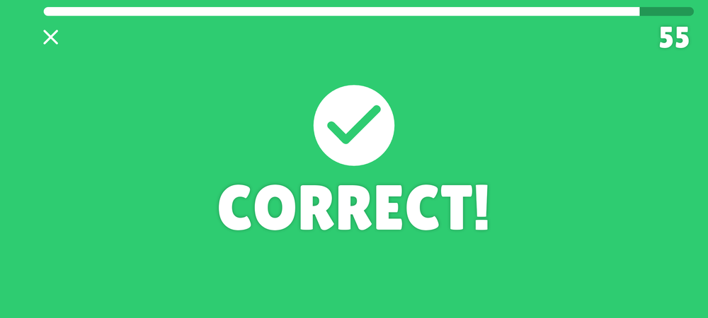
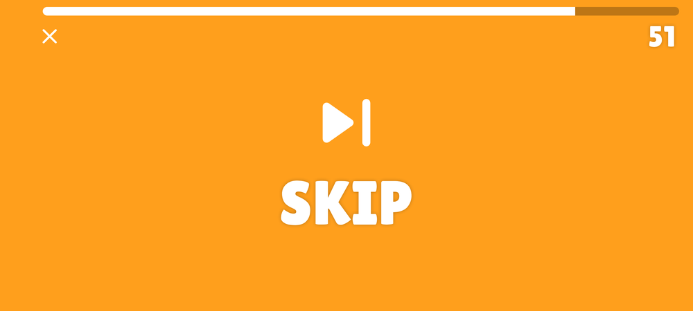

# Void Charade

An offline charades party game for Android, built with Flutter.

One player holds the phone against their forehead (landscape) so the group can see
the word. The group acts it out; the player guesses. Tilt the screen **down** when
they get it, **up** to skip, then the next word appears. When the timer runs out you
get a results screen with every guessed, skipped and unplayed word.

## Free and open source

Void Charade is **completely free** and **open source** ([MIT licence](LICENSE)). There is
no catch:

- no ads
- no subscriptions, no in-app purchases, no paid "premium" categories or unlocks
- no tracking, no analytics, no crash reporting, no third-party SDKs that phone home
- no accounts, no sign-in, no personal data collected
- no network access at all: it works fully offline and everything is bundled in the app
- no hidden limits: every category, language and setting is available to everyone

You can read the code, build it yourself, change it and share it.

## Features

- 50 categories (6 of them 18+), about **20 000 words per language**, in **Italian and English**
- UI in Italian or English (follows the device, switchable), plus a separate "word language"
- Round length 30-180 s, countdown 3-10 s, optional "skip = -1 point"
- Sounds, vibration and final-seconds ticking, each with its own toggle
- Tilt sensitivity (strict / normal / relaxed), swappable tilt directions, or **touch controls** instead of tilt
- "Random category" and "Mix all" modes, words never repeat within a round
- Dark, colourful party look with animations and confetti

> Status: v1.0.0. Single-round mode (no teams or scoreboard yet). Tested on a real
> Android phone.

## Screenshots

<p align="center">
  
  
  
</p>

<p align="center">
  
  
  
</p>

<p align="center"><sub>Home, results and settings (top row); a word, a correct answer and a skip during a round (bottom row, with touch controls turned on).</sub></p>

## Compatibility

**Android 7.0 (API 24) and newer**, up to Android 16 (API 36, the target version).
Builds include ARM (64 and 32-bit) and x86-64. Tested on a real phone only. Tilt play
needs an accelerometer; without one, use *Touch controls*.

The app is locked to portrait on the menus and switches to landscape during a round.
The only permission it asks for on Android is `VIBRATE`.

## How to play

1. Pick a category (or *Random category* / *Mix all*) on the home screen.
2. A countdown runs ("Put the phone on your forehead!").
3. Words appear one at a time. Tilt the screen toward the floor for **correct**, toward
   the ceiling for **skip**. Bring the phone back upright for the next word.
4. When time is up, the results screen lists guessed, skipped and not-played words
   (the word on screen when the clock ran out) and the score.

During a round you can only quit (with confirmation); there is no pause. If the app goes
to the background the clock freezes and resumes after a 3-second "Get ready" countdown.

With **Settings > Touch controls** the screen is split in two halves instead: tap the right
half for correct and the left half to skip. Tilt is ignored in that mode.

## Settings

| Setting | Options (default first) |
| --- | --- |
| App language | System (Italian if the device is Italian, else English) / Italiano / English |
| Word language | Same as app / Italiano / English |
| Round duration | 30-180 s in 15 s steps (60 s) |
| Countdown | 3-10 s (5 s) |
| Skip costs 1 point | off / on |
| Touch controls | off / on |
| Tilt sensitivity | Normal / Strict / Relaxed |
| Swap tilt directions | off (screen down = correct) / on |
| Sounds, final-seconds ticking, vibration | on / off each |
| Show 18+ categories | on / off |

## Categories

Animals, Food, Kitchen, Things at Home, Places, Jobs, Actions, Sports, Football, Movies,
TV Series, Cartoons, Disney & Pixar, Fictional Characters, Celebrities, Historical Figures,
Singers & Bands, Songs, Music & Instruments, Video Games, Books, Fairy Tales & Myths,
Fantasy & Sci-Fi, Horror, Geography, Landmarks, Italy, Travel, Summer, Celebrations, Nature,
Body & Health, Clothes, Science & Tech, Inventions, Internet, Brands, School & Office,
Hobbies, Toys & Games, 80s & 90s, Idioms, Theater, Easy Words, and the 18+ categories
Party, Drinks, Love & Dating, Awkward Situations, Slang & Swear Words and Spicy.

The English and Italian lists are written separately for each culture, not translated
(Italian lists use Italian titles, TV, songs and slang).

## Getting started (development)

Requirements: Flutter 3.47 (Dart 3.13), Android Studio with the Android SDK and
command-line tools, and a phone with USB debugging.

```bash
git clone <this repository>
cd charade/void_charade
flutter pub get
flutter analyze
flutter test        # ~130 tests, fully offline, no device needed
flutter run         # debug build on the connected phone
```

Debug builds add a pitch overlay and a bug button that fakes the sensor (tap left = skip,
tap right = correct) so a round can be played without tilting. Release builds do not.

> If you add or remove word files and the app shows old categories, run `flutter clean`
> once: Gradle can reuse a cached asset bundle.

## Project layout

```
.
├── LICENSE, THIRD_PARTY_NOTICES.md, README.md, CLAUDE.md
├── docs/IMPLEMENTATION_PLAN.md      original design and decisions log
└── void_charade/                    the Flutter app
    ├── lib/
    │   ├── core/                    router, theme, system UI mode
    │   ├── features/
    │   │   ├── categories/          category index, word loading, home screen
    │   │   ├── game/                tilt detector, game engine, controller, screen
    │   │   ├── results/             round result model, results screen, confetti
    │   │   └── settings/            settings model, storage, screen
    │   ├── services/                sound, haptics, event-to-feedback mapping
    │   └── l10n/                    app_en.arb, app_it.arb (+ generated localizations)
    ├── assets/
    │   ├── categories.json          category ids, names, emoji, colours, 18+ flag
    │   ├── words/{en,it}/<id>.txt   one word list per category and language
    │   ├── sounds/                  generated sound effects
    │   ├── branding/                logo, icon and splash images
    │   └── fonts/                   Lilita One, Nunito + their licences
    ├── tool/                        content validator and asset generators
    └── test/                        unit, content and widget tests
```

## How it works

- **GameEngine** (`lib/features/game/game_engine.dart`) is a pure-Dart state machine
  (countdown, waiting upright, playing, feedback, resuming, time up, finished). It has no
  clock and no sensors: callers pass a monotonic time and accelerometer samples, so every
  timing rule is unit-tested with synthetic time.
- **TiltDetector** turns accelerometer samples into one event per tilt: low-pass filter,
  pitch `atan2(z, hypot(x, y))`, a trigger angle and a smaller "back to upright" angle
  (hysteresis), plus a 600 ms pause before the next word.
- **GameController** (Riverpod) connects the engine to a stoppable stopwatch, the
  accelerometer and the app lifecycle. **FeedbackService** maps game events to sounds and
  vibration using the settings that are live at that moment.
- State management is Riverpod, navigation is go_router, settings live in
  shared_preferences, localisation uses Flutter's gen-l10n.

### Tilt sensitivity

Angles are measured from upright (0°, phone on the forehead; 90° = screen flat):

| Level | Tilt needed | Must return within |
| --- | --- | --- |
| Strict | 60° | 25° |
| Normal | 50° | 25° |
| Relaxed | 35° | 20° |

The levels are defined by `TiltSensitivity` in `void_charade/lib/features/settings/settings.dart`.

## Word lists

Lists are plain UTF-8 text, one entry per line, in `assets/words/<en|it>/<category_id>.txt`.
Categories are declared in `assets/categories.json`. Rules enforced by the validator:

- LF line endings, no BOM, trailing newline, no blank lines
- at most 30 characters and 5 words per entry
- letters (accents allowed), digits, spaces and `' - . & ! ? , : /` only
- no duplicates within a file (case, accents and leading articles such as *the* / *il* are ignored)
- at least 300 entries per file; every category needs a file in both languages

```bash
cd void_charade
dart run tool/validate_words.dart            # errors and warnings
dart run tool/validate_words.dart --strict   # a missing word file counts as an error
dart run tool/validate_words.dart --seed 7   # reproducible spot-check sample
```

The validator also writes `build/spot_check_en.md` and `build/spot_check_it.md` with 20
random entries per category for quick review. It runs as part of `flutter test`.
Words that appear in several categories are only warnings: *Mix all* removes duplicates.

To add a category: add it to `categories.json` (snake_case id, emoji, `#RRGGBB` colour,
`adult` flag, names in both languages), add both word files, run the validator.
To add a language, see `contentLanguages` in `tool/content_validator.dart`,
`supportedLanguageCodes` in `lib/features/settings/settings.dart` and the `.arb` files.

## Generated assets

| Asset | How to regenerate (from `void_charade/`) |
| --- | --- |
| Sound effects (`assets/sounds/*.wav`) | `dart run tool/generate_sounds.dart` |
| Logo, icon, splash images (`assets/branding/`) | `flutter test tool/generate_branding_test.dart` |
| Android launcher icons | `dart run flutter_launcher_icons` |
| Native splash screens | `dart run flutter_native_splash:create` |

## Building a release

1. Release signing uses `void_charade/android/key.properties`, which is git-ignored and
   points to a keystore kept outside the repository:

   ```properties
   storePassword=...
   keyPassword=...
   keyAlias=void_charade
   storeFile=C:/path/to/void_charade-release.jks
   ```

   Create one with:

   ```bash
   keytool -genkeypair -v -keystore void_charade-release.jks -storetype PKCS12 \
     -alias void_charade -keyalg RSA -keysize 2048 -validity 10000
   ```

   **Back up the keystore and its password.** Without them you cannot update an installed
   app. Without `key.properties` the release build falls back to the debug key, which is
   fine for quick tests but not for distribution.

2. Build and install:

   ```bash
   cd void_charade
   flutter build apk --release
   adb install -r build/app/outputs/flutter-apk/app-release.apk
   ```

   The APK is at `build/app/outputs/flutter-apk/app-release.apk` (about 53 MB, universal).
   Raise `version:` in `pubspec.yaml` (for example `1.0.1+2`) for every new release; the
   number after `+` must increase for Android to accept an update. An APK signed with a
   different key can only be installed after uninstalling the old one.

## Privacy

The app has no network code and requests no network permission in release builds (the
INTERNET permission exists only in debug/profile builds, for Flutter tooling). The only
Android permission is `VIBRATE`. Settings are stored locally on the device. Nothing is
collected or sent anywhere.

## Not in v1

Teams and multi-round scoreboards, custom categories or user-supplied words, difficulty
levels, manual correction of results, more languages, store release (privacy policy and
store listings).

## Contributing

Issues and pull requests are welcome, especially word-list improvements (typos, wrong
titles, entries nobody would know, better local references) and new languages. Please run
`flutter analyze`, `flutter test` and the word validator before opening a pull request.
Keep entries tasteful: no slurs or hateful content (the 18+ categories may be cheeky), no
real private individuals, and keep real public figures to well-known, non-defamatory names.

## Licence and credits

- Code, tests, tools, word lists, generated sounds and images: [MIT](LICENSE).
- Fonts: Lilita One and Nunito, SIL Open Font License 1.1 (kept under their own licence).
- Flutter and pub packages: BSD / MIT / Apache-2.0 (licences shown in the app under
  Settings > About > View licenses).

Details and the origin of every asset are in [THIRD_PARTY_NOTICES.md](THIRD_PARTY_NOTICES.md).
Word lists were written with the help of an AI assistant (Claude) and reviewed with a script.

Void Charade is an independent project, not affiliated with or endorsed by any company,
game, show or person named in its word lists; those names belong to their owners and are
used only as words to guess.
